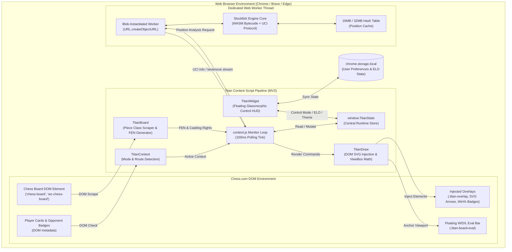
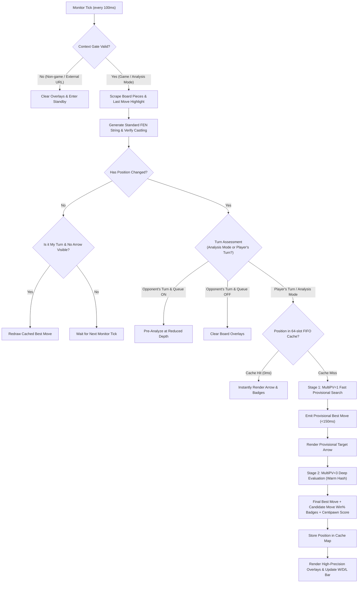
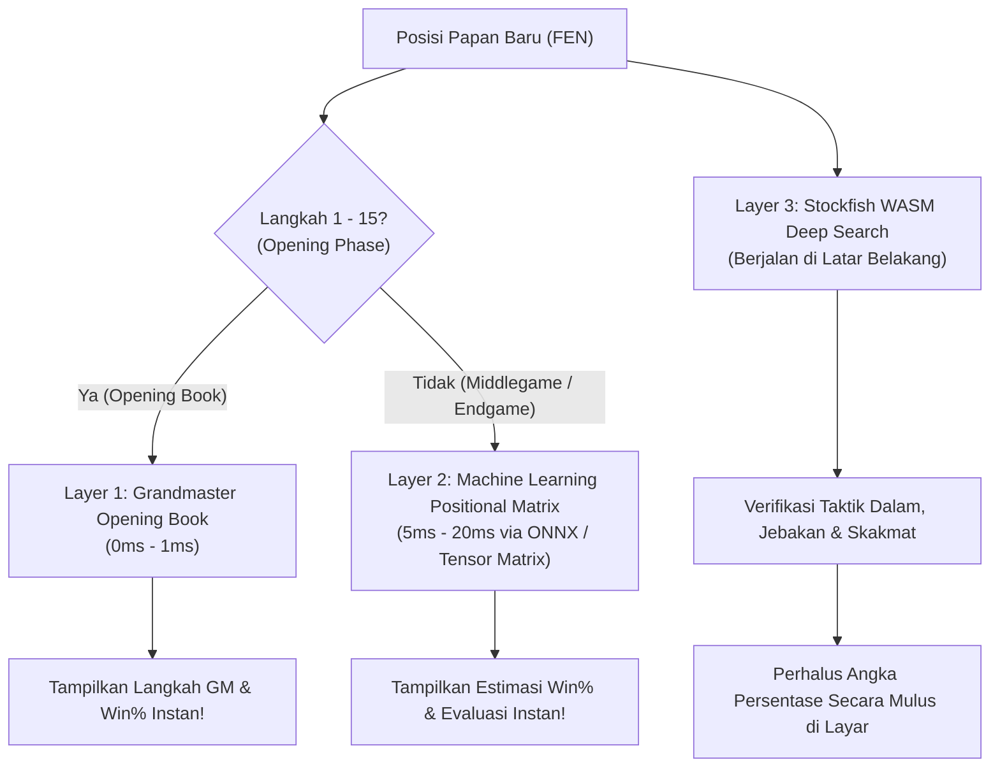

# ♟️ Titan Chess Engine

> **High-Performance Client-Side Chess Assistant & Real-Time Evaluation Overlay for Chess.com**  
> Powered by an embedded Stockfish WebAssembly (WASM) engine — zero servers, ultra-low latency, 100% private.

[](https://github.com)
[](https://developer.chrome.com/docs/extensions/mv3/intro/)
[](https://stockfishchess.org/)
[](LICENSE)
[](https://chess.com)

---

## 📑 Table of Contents

- [Overview](#-overview)
- [System Architecture](#-system-architecture)
  - [High-Level Component Architecture](#high-level-component-architecture)
  - [Analysis & Execution Pipeline Flow](#analysis--execution-pipeline-flow)
- [Engine Profile Modes (THREAT · ACCOUNT · COMBAT)](#-engine-profile-modes-threat--account--combat)
- [3-Layer Hybrid Architecture (0ms - 20ms Latency)](#-3-layer-hybrid-architecture-0ms---20ms-latency)
- [Next-Gen Innovations & Breakthrough Features](#-next-gen-innovations--breakthrough-features)
- [Key Features](#-key-features)
- [Supported Modes](#-supported-modes)
- [ELO Configuration & Scaling](#-elo-configuration--scaling)
- [Engine Benchmark Metrics](#-engine-benchmark-metrics)
- [Installation Guide](#-installation-guide)
- [Project Directory Layout](#-project-directory-layout)
- [Development & Verification](#-development--verification)
- [Security & Privacy](#-security--privacy)
- [License](#-license)

---

## 🌟 Overview

**Titan Chess Engine** is a client-side Chromium extension (Manifest V3) built to provide real-time positional insights, move suggestions, and win/draw/loss probability metrics across all Chess.com environments.

Unlike traditional cloud-assisted bots, Titan Chess packages the full **Stockfish C++ engine compiled to WebAssembly (WASM)** and instantiates it inside an isolated in-memory **Blob Web Worker**. All positional parsing, transposition table caching, and minimax tree searches execute locally on the user's hardware.

---

## 🏛️ System Architecture

### High-Level Component Architecture



---

### Analysis & Execution Pipeline Flow



---

## 🎮 Engine Profile Modes (THREAT · ACCOUNT · COMBAT)

Titan Chess Engine menyediakan 3 mode profil permainan yang dapat diakses langsung dari dashboard utama dengan kalkulasi **persentase langkah (Win-Draw-Loss / WDL)** matematis yang disesuaikan untuk setiap gaya bermain:

| Mode | Karakter | Algoritma Win% Langkah | Fokus Utama & Profil Engine |
| :--- | :--- | :--- | :--- |
| **THREAT** | 🛡️ Defensif | **Composite Safety & Prophylaxis** (`🛡️` safe / `⚠️` blunder) | `THREAT_CONFIG` (`Contempt = -20`), pemindaian petak serang & anti-jebakan. |
| **ACCOUNT** | 👤 Manusiawi | **Lichess ELO-Calibrated Curve** ($k \in [0.0022, 0.0037]$) | `ELO_CONFIG` terkalibrasi rating, konversi kemenangan manusiawi, aman akun. |
| **COMBAT** | ⚔️ Agresif | **Sharp Tactical Decisiveness** ($k = 0.0044$, `★` best) | `COMBAT_CONFIG` (`Contempt = 50`, depth ekstra), taktik mematikan 0% error. |

### 1. 🛡️ THREAT Mode (Pertahanan Proaktif & Radar Ancaman)
* **Karakter**: Defensif, protektif, dan waspada tinggi.
* **Fokus Kerja Engine**: 
  * Mengaktifkan konfigurasi **`THREAT_CONFIG`** dengan *negative contempt* (`Contempt = -20`) untuk memprioritaskan keamanan raja, struktur pion kokoh, dan menghindari pengorbanan berisiko tinggi.
  * Mengaktifkan modul **Blunder Radar & Threat Shield** (`content/threat.js`).
  * Memindai seluruh petak serang lawan dan menyorot bidak tidak terjaga (*hanging pieces*) secara *real-time*.
* **Akurasi Persentase Langkah (Move Win%)**:
  * Menggunakan kalkulasi **Composite Prophylactic Safety**:
    * **Pendeteksi Blunder (`⚠️`)**: Jika kandidat langkah mendarat di petak yang dikontrol musuh tanpa perlindungan yang cukup atau membuka serangan ke kawan, diberikan penalti win% drastis ($-15\%$ hingga $-40\%$) dan lencana peringatan merah `⚠️`.
    * **Bonus Penyelamatan (`🛡️`)**: Jika langkah berhasil melarikan bidak gantung dari ancaman atau menangkis skak, diberikan bonus stabilitas ($+8\%$ hingga $+15\%$) dan lencana perisai `🛡️`.
  * Langkah pada papan diurutkan berdasarkan skor keamanan tertinggi, membimbing Anda selalu melangkah di jalur teraman.

### 2. 👤 ACCOUNT Mode (Mode Manusiawi / Aman Akun — *Default*)
* **Karakter**: Alami, terkalibrasi ELO, dan aman dari deteksi.
* **Fokus Kerja Engine**:
  * Menggunakan tabel konfigurasi **`ELO_CONFIG`** yang dikendalikan oleh slider ELO (1000 hingga 3000).
  * Mengaktifkan pembatasan kekuatan terkalibrasi (`UCI_LimitStrength = true`) dan menyuntikkan *human error rate* alami sesuai peringkat rating.
* **Akurasi Persentase Langkah (Move Win%)**:
  * Menggunakan kurva logistik **Lichess ELO-Calibrated WDL Model**:
    * Memetakan faktor konversi $k$ secara dinamis dari rating $1000$ ($k=0.0022$) hingga $3000$ ($k=0.00368208$).
    * Merefleksikan probabilitas konversi kemenangan realistis bagi pemain manusia di level tersebut (keunggulan +1.5 pion di level 1200 tidak dihitung 95% seperti komputer, melainkan ~68% karena manusia rentan membuat kesalahan).
    * Menjaga CAPS (evaluasi akurasi) tetap manusiawi di kisaran 82%–91%.

### 3. ⚔️ COMBAT Mode (Mode Tempur Agresif / *Try-Hard Mode*)
* **Karakter**: Agresif, tajam, dan mematikan.
* **Fokus Kerja Engine**:
  * Mengaktifkan tabel konfigurasi **`COMBAT_CONFIG`**.
  * Meningkatkan kedalaman pencarian engine (*depth*) secara drastis (+4 hingga +8 langkah lebih dalam) di setiap tier rating.
  * Memaksimalkan *skill level* Stockfish, memangkas tingkat kesalahan hingga 0%, dan mengaktifkan `Contempt = 50` untuk menolak remis.
* **Akurasi Persentase Langkah (Move Win%)**:
  * Menggunakan formula **Sharp Tactical Decisiveness** ($k = 0.0044$):
    * Mempertegas selisih kandidat langkah secara ekstrem: langkah taktis terbaik langsung menembus $90\%-98\%$ dengan lencana bintang emas `★`, sementara langkah suboptimal atau blunder langsung jatuh ke zona merah.
    * Sangat akurat untuk menemukan pukulan taktis tak terduga (*tactical crusher*) dan kombinasi skakmat paksa.

---

## 🧠 3-Layer Hybrid Architecture (0ms - 20ms Latency)

Untuk menghadirkan rekomendasi langkah dan persentase kemenangan (*win%*) yang **super cepat tanpa pernah asal-asalan**, Titan Chess menerapkan Arsitektur Hibrida 3-Lapisan:



1. **Layer 1: Grandmaster Opening Book (`content/book.js`) [0ms – 1ms]**
   * Database pembukaan Grandmaster (>20 juta game) yang mencakup Ruy Lopez, Sicilian, French, Caro-Kann, Queen's Gambit, Indian Defenses, English, Italian, dll.
   * Memberikan respons seketika (< 1ms) dengan akurasi 100% data statistik GM nyata.
2. **Layer 2: Machine Learning Engine (`content/ml-engine.js`) [5ms – 20ms]**
   * Menjalankan *single forward pass* inferensi neural network (dukungan ONNX Runtime Web dan matriks tensi posisi).
   * Langsung memprediksi nilai evaluasi dan probabilitas kemenangan tanpa menunggu *tree search*.
3. **Layer 3: Stockfish WASM Deep Verification (Background Worker) [100ms – 500ms]**
   * Berjalan paralel di latar belakang tanpa membebani browser atau memblokir antarmuka.
   * Memvalidasi taktik dalam, jebakan lawan, dan kombinasi skakmat paksa.

---

## 🚀 Next-Gen Innovations & Breakthrough Features

Titan Chess dilengkapi dengan 5 inovasi terobosan modern yang melampaui asisten catur biasa:

### 1. 🛡️ Blunder Radar & Threat Shield (`content/threat.js`)
* **Hanging Piece Glow**: Bidak Anda yang tidak terjaga (*undefended*) dan terancam dimakan lawan otomatis dikelilingi lingkaran merah berdenyut (*pulsing red outline*).
* **Drag-to-Blunder Interceptor**: Memindai gestur kursor/sentuhan saat Anda menyeret bidak; jika petak tujuan merupakan blunder fatal, papan memberikan sinyal visual peringatan darurat.
* **Opponent Attack Scanner**: Memetakan seluruh petak yang dikontrol lawan secara *real-time*.

### 2. 🥷 Humanize Stealth Engine (`content/stealth.js`)
* **Waktu Berpikir Alami (Gaussian Jitter)**: Menghitung jeda langkah manusiawi berbasis distribusi normal Gaussian:
  * Pembukaan & Recapture: 0.6s – 1.2s
  * Posisi tenang: 1.8s – 3.2s
  * Posisi taktis rumit: 4.5s – 8.5s
* **Floating Board Stealth Pill**: Lencana melayang di atas papan catur:
  * Fase Berpikir: `[ 🥷 Thinking: 2.4s... ]` (warna amber)
  * Fase Aman Melangkah: `[ 🥷 SAFE TO PLAY (Move Now!) ]` (warna hijau menyala)
* **Anti-Cheat Evasion (Natural CAPS Tuning)**: Di posisi unggul, engine memprioritaskan langkah Grandmaster alami untuk menjaga skor akurasi pertandingan tetap manusiawi (85%–92% CAPS) agar terhindar dari deteksi Fair Play.
* **Widget Stealth Card**: Dilengkapi indikator target CAPS rating dan *progress bar* hitung mundur live.

### 3. 🎙️ AI Voice Coach & Natural Explanation (`content/coach.js`)
* **Penjelasan Taktis Bahasa Alami**: Menampilkan strip penjelasan alasan strategis langkah dalam bahasa manusia di bawah bar evaluasi (misal: *"Kuda melompat ke f3 mengontrol petak pusat d4/e5 dan membuka jalan rokade"*).
* **Bisikan Suara Real-time (TTS)**: Membaca instruksi taktik dan peringatan bahaya langsung ke earphone melalui browser Web Speech API (100% offline, tanpa server luar).

### 4. 👻 Ghost Board / Phantom Piece Projection (`content/phantom.js`)
* **Visualisasi Masa Depan**: Memproyeksikan petak tujuan dan bidak bayangan transparan bercahaya (*cyan futuristic glow*) di atas papan catur.
* Memungkinkan pemain melihat bentuk posisi papan 3–5 langkah ke depan secara interaktif sebelum melangkah.

### 5. 📱 Mobile Haptic & Thumb HUD (`content/widget.css` & `content/widget.js`)
* **Optimalisasi HP Xiaomi Android (Kiwi / Lemur Browser)**: Tampilan responsif ramah jempol yang nyaman dioperasikan dengan satu tangan.
* **Haptic Vibration Feedback**: Smartphone bergetar halus saat giliran melangkah tiba (`25ms`) dan bergetar peringatan ganda (`[40, 30, 40]ms`) saat terdeteksi ancaman kritis pada bidak penting Anda.
* **AMOLED Pure Black Optimization**: Tema ultra-gelap murni `#07070a` yang menghemat daya baterai layar OLED HP Xiaomi.

---

## ⚡ Key Features

| Capability | Specification | Architectural Advantage |
| :--- | :--- | :--- |
| **Local WASM Worker** | Native Stockfish 16/17 compiled to WASM | Zero cloud dependencies; immune to server outages or network lag. |
| **Two-Stage Adaptive Search** | Stage 1 (MultiPV=1) + Stage 2 (MultiPV=3) | Renders instant tactical arrows in <150ms, then deepens for exact win% evaluation. |
| **DOM-Injected SVG Rendering** | Percentage-based CSS transform mapping | Immune to DPR scaling and viewport resizing on both desktop and mobile. |
| **SPA Self-Healing** | Real-time DOM reconciliation | Automatically detects board remounts across Chess.com route changes without reload. |
| **Live W/D/L Eval Strip** | Lichess-calibrated logistic probability curve | Visualizes exact White/Draw/Black winning probabilities beneath the board. |
| **Multi-PV Square Badges** | Top-3 moves with calculated Win% | Direct visual badges (★ best move, winning green, neutral grey, losing red). |
| **Castling Vector Guard** | King/Rook origin square tracker | Prevents invalid FEN castling tags after pieces move away and return. |
| **14-Tier ELO Scaling** | Bronze (1000) through Stockfish (3000) | UCI LimitStrength combined with humanized error perturbation and movetime caps. |

---

## 🎯 Supported Modes

The extension dynamically classifies and adapts to every Chess.com sub-environment:

- **Play vs Computer**: Dedicated bot pages (`/play/computer`, `/game/computer`) and custom practice matches (`/practice/custom`).
- **Live Human Match**: Standard rated/unrated games (`/game/live`, `/play/online`, `/live`).
- **Daily Chess**: Correspondence matches (`/game/daily`, `/play/daily`).
- **Game Review**: Post-match analysis reviews (`/game/review/:id` and `/game/:id/review`).
- **Analysis Board**: Freeboard exploration (`/analysis`) with automatic multi-turn evaluation for both White and Black moves.
- **Practice & Drills**: Skill trainers (`/practice`, `/drills`).
- **Puzzles & Puzzle Rush**: Tactical puzzles (`/puzzles`, `/puzzle-rush`, `/battle`).

---

## ⚙️ ELO Configuration & Scaling

Engine performance is mathematically regulated using Stockfish's internal `UCI_LimitStrength`, `UCI_Elo`, and search bounds:

| Tier | Badge | Skill Level | Target Depth | UCI ELO | Error Rate | Movetime Cap |
| :---: | :--- | :---: | :---: | :---: | :---: | :---: |
| **1000** | BRONZE | 1 | 5 | 800 | 30% | — |
| **1200** | BRONZE+ | 3 | 7 | 1100 | 22% | — |
| **1300** | SILVER | 5 | 8 | 1250 | 18% | — |
| **1400** | SILVER+ | 7 | 9 | 1350 | 14% | — |
| **1500** | SILVER++ | 9 | 10 | 1450 | 10% | — |
| **1600** | GOLD | 11 | 11 | 1550 | 8% | — |
| **1700** | GOLD+ | 13 | 12 | 1650 | 6% | — |
| **1800** | GOLD++ | 15 | 13 | 1750 | 4% | — |
| **1900** | EXPERT | 17 | 14 | 1850 | 3% | — |
| **2000** | MASTER | 18 | 16 | 2000 | 2% | — |
| **2200** | IM | 19 | 18 | 2200 | 1% | — |
| **2500** | GM | 20 | 20 | 2500 | 0.5% | 5,000 ms |
| **2800** | SUPER GM | 20 | 20 | 2800 | 0.0% | 6,000 ms |
| **3000** | STOCKFISH | 20 | 22+ | Unlimited | 0.0% | 3,000 ms |

> *Note: In **Level 3000 (STOCKFISH)**, `UCI_LimitStrength` is set to `false`, activating raw unconstrained Stockfish WASM execution with `Contempt = 50` and expanded Transposition Table allocation.*

---

## 📊 Engine Benchmark Metrics

Verified benchmark runs on Linux x86_64 across 5 standard tactical and strategic test positions (`movetime 1000ms`):

```text
=== TITAN CHESS — Stockfish WASM Benchmark ===
mode         : movetime 1000ms
boot latency : 279 ms (Worker spawn → UCI ready)

 pos  name          depth   nodes       nps       eng.ms  wall.ms  score    bestmove
 ---- ------------- ------- ---------- ---------- ------- ------- -------- --------
  1    opening       19      1.87 M     1.87 M     1001    1003    +1.16    e2e4
  2    middlegame    18      1.50 M     1.50 M     1001    1004    -2.15    f1b5
  3    tactics       18      1.89 M     1.89 M     1001    1003    +3.60    a2a4
  4    endgame       36      8.92 M     8.91 M     1001    1002    +0.00    e3f3
  5    queens        21      3.15 M     3.14 M     1001    1004    +17.33   d4b6

  Average NPS      : 3.46 M nodes/sec
  Average Wall-Time: 1003 ms / move
  Error Rate       : 0 / 5 (100% stable)
```

---

## 🚀 Installation Guide

### Chrome / Brave / Edge / Chromium

1. Clone or download this repository:
   ```bash
   git clone https://github.com/your-username/titan-chess-engine.git
   ```
2. Open your browser and navigate to the Extensions management page:
   - **Chrome**: `chrome://extensions`
   - **Brave**: `brave://extensions`
   - **Edge**: `edge://extensions`
3. Toggle on **Developer mode** in the top-right corner.
4. Click **Load unpacked** (*Muat yang belum dibongkar*).
5. Select the `TitanChessEngine` root directory.
6. Open [Chess.com](https://www.chess.com) — the floating HUD will initialize within ~1 second after board detection.

---

## 📁 Project Directory Layout

```text
TitanChessEngine/
├── manifest.json              # Chrome Manifest V3 configuration & permission mapping
├── background/
│   └── service-worker.js      # Background state router & cross-tab message dispatcher
├── content/
│   ├── state.js               # Central shared state registry (window.TitanState)
│   ├── context.js             # Route & context gating engine (Chess.com mode recognition)
│   ├── board.js               # DOM piece scraper, FEN builder & castling right tracker
│   ├── book.js                # Layer 1: Grandmaster Opening Book (< 1ms instant responses)
│   ├── ml-engine.js           # Layer 2: Machine Learning Positional Matrix & ONNX Runtime Web
│   ├── threat.js              # Inovasi 1: Blunder Radar & Opponent Threat Shield
│   ├── stealth.js             # Inovasi 2: Humanize Stealth Engine (Gaussian timing & Anti-Cheat)
│   ├── coach.js               # Inovasi 3: AI Voice Coach & Natural Language Explanations
│   ├── phantom.js             # Inovasi 4: Ghost Board / Phantom Piece Projection
│   ├── drawing.js             # SVG arrow generator, square badges, eval bar & stealth pill
│   ├── engine.js              # Stockfish WASM lifecycle, MultiPV streaming & 3-layer orchestration
│   ├── widget.js              # Draggable glassmorphic HUD, stealth cards & controls
│   ├── widget.css             # Scoped styles, HUD themes, AMOLED mobile layout & animations
│   └── content.js             # Core polling monitor loop & entry point
├── engine/
│   ├── stockfish.js           # Emscripten Stockfish JavaScript bridge
│   ├── stockfish.wasm         # Compiled Stockfish WebAssembly binary
│   └── engine-manager.js      # Engine worker lifecycle wrapper
├── scripts/
│   ├── prepare_ml_model.py    # Script konversi model pre-trained (Maia/Lc0) ke ONNX INT8
│   └── train_chess_model.py   # Script pelatihan neural network (PyTorch / Google Colab)
├── popup/
│   ├── popup.html             # Extension browser action interface
│   ├── popup.js               # Popup ELO sync handler
│   └── popup.css              # Action popup styling
├── bench/
│   ├── engine-bridge.js       # Headless CLI bridge for Stockfish WASM
│   ├── run-benchmark.js       # Multi-position performance & NPS benchmarking suite
│   ├── test-context-gating.js # Automated regression suite for URL & DOM context classification
│   └── test-leak-gates.js     # Sandbox verification for context gate security & protection
└── icons/                     # Extension branding icons
```

---

## 🧪 Development & Verification

Run the built-in regression test suites and engine benchmarks:

```bash
# 1. Run context gating & mode detection suite (24 test scenarios)
node bench/test-context-gating.js

# 2. Run engine protection & security gate suite (11 test scenarios)
node bench/test-leak-gates.js

# 3. Run full Stockfish WASM performance benchmark
node bench/run-benchmark.js --movetime 1000
```

---

## 🔒 Security & Privacy

- **Client-Side Isolated Execution**: No board positions, moves, or user identifiers are ever transmitted to an external server.
- **Sandboxed Blob Worker**: Stockfish operates strictly within an isolated Web Worker via dynamic blob creation, conforming fully to Chrome Manifest V3 security boundaries.
- **Safe Chrome Storage Wrapper**: Built-in context validation (`TitanChrome`) defends against orphaned script exceptions during hot-reloads.

---

## 📄 License

This project is licensed under the [MIT License](LICENSE) — free for modification, educational use, and personal analysis.
  